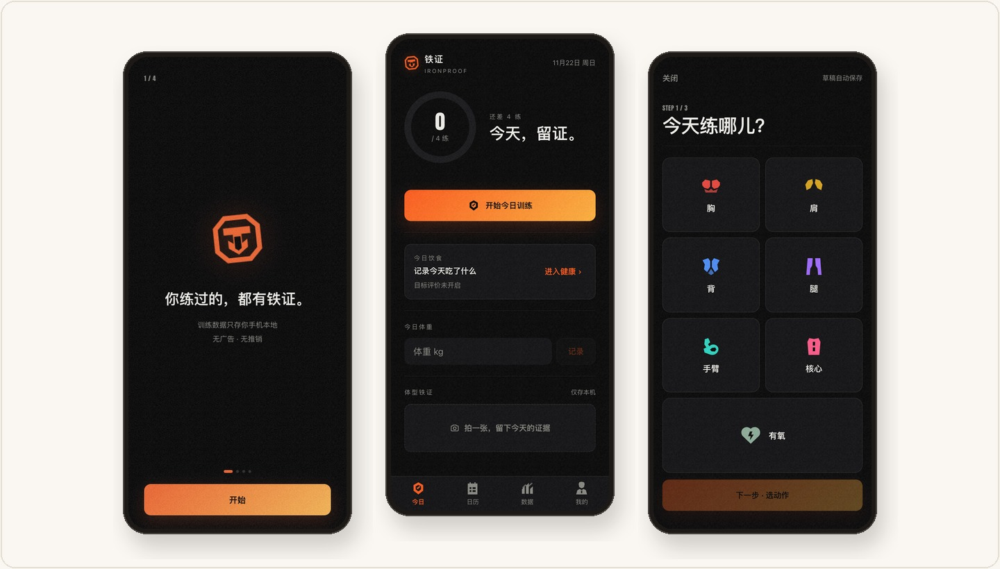

<div align="center">

# 铁证 · IRONPROOF

**你练过的，都有铁证——为健身爱好者打造的本地优先训练、营养与海报 PWA。**

<p>
  <a href="https://tiezheng.pages.dev/"><strong>打开应用 ↗</strong></a> ·
  <a href="#核心体验">核心体验</a> ·
  <a href="#快速开始">本地开发</a> ·
  <a href="#english">English</a>
</p>

<p>
  <a href="https://github.com/nuts-and-bytes/tiezheng/actions/workflows/ci.yml"></a>
</p>

<br />



</div>

## 为什么做它

健身和饮食最怕「凭感觉」，而市面上多数工具不是广告弹窗满天飞，就是恨不得把所有记录都锁进云端订阅里。

我干脆给自己打了一本硬朗、克制、零打扰的随身账本：打开就能选部位记一组，随手记体重、饮食和体型照片，攒久了能回看清晰的力量趋势，还能一键在本地渲染一张给自己打气的训练海报。

> **最佳体验**：在手机 Safari / Chrome 打开 [tiezheng.pages.dev](https://tiezheng.pages.dev/) → 分享 → **添加到主屏幕**，即可像原生 App 一样离线使用。

## 核心体验

- **今日与快速记录**：一键按部位（胸 / 肩 / 背 / 腿 / 手臂 / 核心 / 有氧）进入动作记录，草稿自动保存，不打断组间节奏。
- **日历回看**：按月份和日期回溯每一次训练、体型铁证照片与当天明细。
- **数据趋势**：追踪训练频率、动作容量与重量曲线，进步看得见。
- **饮食与营养**：内置常见食物预设快速记三餐与热量汇总；可选的自动营养目标及文字/照片 AI 估算受独立开关保护，需经用户核对后才入账。
- **本地训练海报**：直接在浏览器 Canvas 绘制并导出月度/年度训练战报，无需上传原图。
- **数据主权**：所有核心记录存在本机 IndexedDB，支持完整 JSON 备份导出与一键恢复。

## 快速开始

```bash
git clone https://github.com/nuts-and-bytes/tiezheng.git
cd tiezheng
npm install
npm run dev
```

常用工程脚本：

```bash
npm test            # 全量测试门禁（Vitest + 文字 AI Node 测试套件）
npm run typecheck   # TypeScript 严格模式检查
npm run build       # 类型检查 + 生产构建 → dist/
npm run preview     # 本地预览生产构建与 PWA 行为
npm run icons       # 从 public/logo.svg 重新生成全套 PWA 图标
```

<details>
<summary><strong>技术栈、数据与 AI 边界、CI/CD 部署</strong></summary>

<br />

- **技术栈**：Vite 6 · React 19 · TypeScript (strict) · Tailwind CSS 4 · Zustand 5 · Dexie 4 (IndexedDB) · Chart.js 4 · `vite-plugin-pwa` · Vitest
- **数据与可选 AI 边界**：
  - 核心训练、体重、饮食与照片数据默认保存在当前浏览器 IndexedDB，不自动跨设备同步；清理浏览器数据前请先在「我的」中导出备份。
  - `src/lib/nutritionFeatureFlags.ts` 独立控制自动营养目标、照片 AI 与文字 AI 开关；开启可选 AI 估算时会通过受鉴权的独立网关调用外部模型，估算结果仅作建议，经你确认后才会正式保存。
- **CI 与发布**：[.github/workflows/ci.yml](.github/workflows/ci.yml) 在 PR 阶段执行类型检查、测试、Edge 检查与构建；`main` 分支校验通过后自动部署至 Cloudflare Pages。文字 AI 预览环境由受保护的手动工作流 [.github/workflows/text-ai-preview.yml](.github/workflows/text-ai-preview.yml) 管理。
- **反馈与许可**：问题欢迎提 [Issue](https://github.com/nuts-and-bytes/tiezheng/issues)（请勿附上访问码或个人健康记录）。仓库目前未含独立 `LICENSE` 文件。

</details>

## English

**IRONPROOF (铁证)** is a local-first fitness PWA built with React 19, TypeScript, Tailwind CSS 4, and Dexie (IndexedDB). Track workouts, calendar history, strength & body-weight trends, nutrition logs, progress photos, and generate training posters locally—with full JSON backup/restore and optional, flag-gated AI nutrition estimation.

- [Open app ↗](https://tiezheng.pages.dev/) (Add to Home Screen on mobile for native-like PWA experience)
- Develop locally: `npm install && npm run dev`; run full verification with `npm test && npm run build`.

---

<p align="center">made by <a href="https://heystone.site/">stone</a> · 为 AI 世界留一点人味</p>
